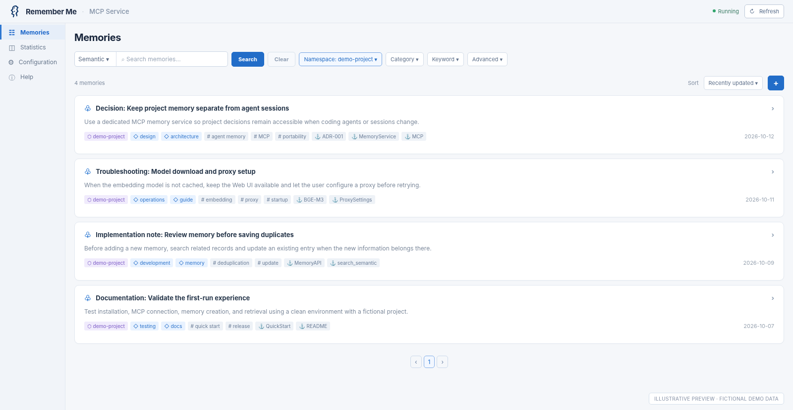
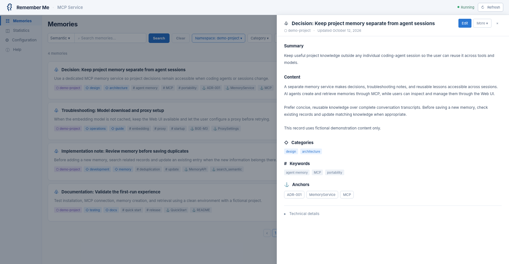
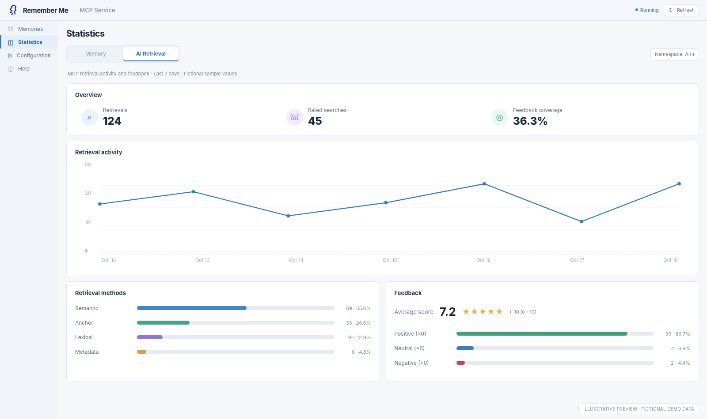

<p align="center">
  <picture>
    <source media="(prefers-color-scheme: dark)" srcset="web/static/img/brand/logo-dark-128.png">
    
  </picture>
</p>

<h1 align="center">Remember Me</h1>

<p align="center">
  <strong>Agent-first memory. Human-visible by design.</strong>
  <br>
  <strong>以 Agent 为中心构建记忆，让人类始终看得见。</strong>
</p>

<p align="center">
  <a href="README.md">English</a> · <a href="README.zh-CN.md">简体中文</a>
</p>

Remember Me 是一个面向 AI Agent 的**本地优先持久化记忆服务**，通过 [Model Context Protocol（MCP）](https://modelcontextprotocol.io/) 为 Agent 提供跨会话的记忆能力。

Agent 是记忆的主要生产者和使用者，可以保存有长期价值的知识、回忆以往决策、更新过去的经验。Web UI 则让用户看见 Agent 记住了什么、这些记忆如何组织，以及记忆如何被检索和使用。

**这是为 Agent 提供的记忆基础设施，而积累的知识始终由用户掌控。**

## 为什么需要 Remember Me？

AI Coding Agent 已经能够完成复杂的工作，但其经验往往被一次次会话分割。一个 Agent 可能调查过问题、比较过方案、做过决策，也从错误中获得过经验；下一次会话开始时，却很难自然地继续利用这些积累。

Remember Me 希望让有价值的知识超越单次对话，成为未来工作可以复用的经验。它遵循三个原则：

**Agent-first：由 Agent 主导记忆。** 记忆的检索、创建和更新主要由 Agent 根据任务与指令完成，不要求用户像维护笔记一样持续手工整理。Remember Me 提供 MCP 工具，实际使用时机由 Agent 决定。

**Retrieval-oriented：为找回和复用而保存。** 记忆不是完整的聊天记录归档。它的价值在于未来需要时，能够根据语义、词语或明确的锚点找回已有知识、决策与经验。

**Human-owned：记忆由用户掌控。** 工作中积累的知识不应被锁定在单个 Agent 或平台中。记忆应当可见、可理解，用户可以检查和管理自己的记忆；开放、可读和可迁移是 Remember Me 的设计原则。Web UI 为此提供观察和管理窗口。

> Agent 可以更换，模型可以升级，工具可以演进，但用户积累的知识和经验应该能够延续。

## 核心功能

- **Agent 驱动的长期记忆**：通过 MCP 创建、检索、更新、删除记忆；由 Agent 根据任务与使用指令决定何时调用。
- **三种检索方式**：Semantic（语义）按含义检索、Lexical（全文）匹配词语、Anchor（锚点）使用明确线索或标识符检索。
- **结构化组织**：Namespace、Category、Keyword、Anchor 帮助跨项目、跨场景整理知识。
- **可观察的 Web UI**：浏览、检索、筛选、查看和编辑记忆，查看记忆分布与检索统计。
- **跨 Agent 访问**：不同兼容 MCP 的客户端可以连接同一个独立的记忆服务，并在适当的 Namespace 中复用积累的记忆。
- **本地优先运行**：SQLite 保存记忆数据，Sentence Transformers 在 Python 进程内运行 **BAAI/bge-m3**，无需独立的模型服务。

**关于数据可迁移性：** 用户控制、可读数据、备份和迁移是项目重视的原则。具体导入导出、备份和恢复能力及文件格式，请以所安装版本的 Help 与运维文档为准；这里不预先承诺所有导入导出流程均已实现。

## 看见 Agent 的记忆

Web UI 主要用于**透明性和可观察性**，而不是让用户每天手动管理笔记。

### Memory Explorer · 记忆浏览与检索

浏览、筛选记忆，选择检索方式，查看 Namespace、Category、Keyword 和 Anchor 等组织信息。



### Memory Detail & Retrieval Statistics · 记忆详情与检索统计

查看单条记忆的内容与关联信息，必要时进行修正；同时观察记忆检索活动与反馈数据。

<p align="center">
  <a href="assets/screenshots/memory-detail.png"></a>
  <a href="assets/screenshots/retrieval-stats.png"></a>
</p>

*以上为基于项目现有界面风格制作的演示预览，使用虚构数据，并非从实际运行服务中直接截取的原始截图。*

## 快速开始

推荐方案：**Python + Sentence Transformers + BAAI/bge-m3**。无需安装 Ollama、Docker 或另外启动 Embedding 服务。

### 1. 安装

需要 Git、支持 `venv` 的 Python 3.10 或更新版本，以及足够运行 BGE-M3 的磁盘空间和内存。以下命令适用于 Linux/macOS 风格的 Shell。

```bash
git clone https://github.com/tech-kuiperbelt/remember-me.git
cd remember-me
bash bin/install.sh
```

安装脚本创建 `.venv`，先安装 CPU-only PyTorch，再锁定该 Torch 版本安装其余依赖。Linux 使用 PyTorch 官方 CPU wheel 索引，macOS 使用 PyPI 上的无 CUDA 发行包。已在 Linux x86_64、Python 3.12 上验收；macOS 尚待实机验证，此 Bash 脚本暂不支持原生 Windows。

CPU 安装请使用脚本：仅执行 `pip install -r requirements.txt` 不能保证选择 CPU wheel。已有 GPU 或损坏环境会使脚本停止；请先保留或重命名原环境，再运行脚本创建干净的 `.venv`。兼容的 CPU 环境可复用。安装流程已包含 Sentence Transformers 依赖。**模型权重不包含在 GitHub 源码仓库中。**

### 2. 启动服务

**默认启动**

```bash
bash bin/start.sh
```

全新安装的默认配置为 **Sentence Transformers + BAAI/bge-m3 + CPU**。已有模型缓存会直接复用；如果缺少模型文件，在支持的“模型尚未就绪”状态下，HTTP/Web UI 仍可启动，模型准备成功后，还需在 Web UI 中手动退出维护模式，才能写入记忆。

已有安装在未显式配置 Provider 时沿用数据库的活动 Embedding Profile，包括历史 Ollama Profile。`bin/start.sh` 会加载本机 `.env`（如存在）。切换 Provider 或模型需要显式指定目标并离线重建索引，详见[运维手册](docs/operations/runbook.zh-CN.md)。

使用默认本地地址和端口时：

| 用途 | 地址 |
| --- | --- |
| Web UI | `http://127.0.0.1:1314/admin/console` |
| 面向 Agent 的配置说明 | `http://127.0.0.1:1314/read-me` |
| MCP — Streamable HTTP | `http://127.0.0.1:1314/mcp` |
| MCP — SSE | `http://127.0.0.1:1314/sse` |

**自定义端口和数据目录**

可以直接向 `bin/start.sh` 传入启动参数：

```bash
# 指定 HTTP 端口
bash bin/start.sh --port 8080

# 本次启动绑定全部接口（例如 Docker bridge 容器内；MCP Host/Origin 防护仍生效）
bash bin/start.sh --host 0.0.0.0

# 指定配置、数据库和模型缓存所在的数据目录
bash bin/start.sh --data-dir /path/to/remember-me-data

# 同时指定端口和数据目录
bash bin/start.sh --port 8080 --data-dir /path/to/remember-me-data
```

`--port` 仅覆盖本次启动使用的端口，不修改配置文件中的端口。使用 `--port 8080` 时，Web UI 地址为 `http://127.0.0.1:8080/admin/console`，MCP 客户端连接地址中的端口也需改为 `8080`。

`--host` 仅覆盖本次启动的绑定地址，只接受 `127.0.0.1` 或 `0.0.0.0`，不会写入配置文件，也不改变由 `local_only` 决定的 MCP Host/Origin 防护。因此 Docker 容器可以监听 `0.0.0.0`，而宿主机只发布 `127.0.0.1:1314:1314`，客户端仍使用 `http://127.0.0.1:1314/...`。端口发布只限制宿主机侧暴露范围：同一 Docker 网络中的其他容器仍可直接访问容器端口。不能与 `--stdio` 同时使用。

`--data-dir` 选择数据目录及其中的 `config.jsonc`，优先级高于 `MEMORY_DATA_DIR` 环境变量。相对路径以项目根目录为基准。选择新目录会使用独立的数据，不会自动搬迁已有数据库或模型缓存。

### 3. 首次下载模型与代理配置

首次使用时可能需要从上游下载 **BAAI/bge-m3**。模型会缓存在本地，下载后可以在本机进行 Embedding 推理，无需持续连接外部模型服务。

如果所在网络需要代理才能访问模型下载源，请打开 Web UI 的**配置页面**，设置模型下载所使用的 HTTP/HTTPS 代理，保存后点击 **Retry（重试）**。后台模型下载失败后，通过代理配置重试不需要重启服务。

**注意：** 只有“本地缺少模型 / 后台下载失败”等可恢复情况，才能保证配置页面仍可用。缺少 Python 依赖、Provider 配置无效、已缓存模型加载严重失败等其他初始化错误，仍可能导致整个服务无法启动；此时应按错误信息及 Help 进行排查，不要将所有启动失败都归因于代理。

**资源提示：** 请为模型和 Python 依赖预留足够的磁盘空间与内存；最低硬件要求仍待验证。

Web UI 的代理设置用于模型下载。通过 pip 安装 Python 依赖时，需要单独配置相应的网络或代理。自动下载模型由 `auto_download_model` 控制；关闭时可在配置页显式发起重试。

## 连接并启用 Agent 记忆

连接 MCP 让 Agent **具备使用记忆的能力**；合适的记忆指令则帮助它知道**何时、如何**使用记忆。两个步骤都很重要。

### 推荐：让 Agent 自动配置 MCP

启动 Remember Me 后，可以向能够访问本地服务、并有权限管理自身配置的 Coding Agent 发送：

> 请阅读 `http://127.0.0.1:1314/read-me`，按照说明为你自己配置 Remember Me MCP，并验证连接。修改配置文件前先征求我的确认。

`/read-me` 是面向 Agent 的配置说明。如需手动操作或排查问题，Web UI 的 **Help** 页面提供详细指导。

### 手动配置示例

**Codex — Streamable HTTP**

```bash
codex mcp add remember-me --url http://127.0.0.1:1314/mcp
codex mcp list
```

**OpenCode — SSE**（将以下示例合并到 OpenCode 配置中，保留已有的 MCP 条目）：

```json
{
  "mcp": {
    "remember-me": {
      "type": "remote",
      "url": "http://127.0.0.1:1314/sse",
      "enabled": true
    }
  }
}
```

不同客户端版本的配置位置与细节请以 Web UI Help 为准。如果 Agent 运行在远程环境，不能在没有网络连接配置的情况下直接访问你电脑上的 `127.0.0.1`。

### 给 Agent 配置记忆使用策略

**MCP 连接成功，不等于 Agent 就会自动记住一切，或总能在正确时机检索到经验。** 长期记忆的效果很大程度上取决于 Agent 的使用策略。

Web UI 的 **Help** 页面准备了可直接复制的记忆提示词。将其放入 Agent 使用的指令文件，例如 `AGENTS.md`，再按项目需要调整。提示词覆盖主动回忆、保存值得复用的决策和经验、写入前去重、更新已有记忆，以及按 Namespace 隔离项目上下文。

### 验证跨会话记忆

1. 请 Agent 在指定项目 Namespace 中保存一条非敏感的测试记忆。
2. 开始一个新的 Agent 会话，让它从相同 Namespace 中检索刚才的内容。
3. 打开 Web UI，查看这条记忆和可用的检索活动。
4. 如有需要，验证后删除测试记忆。

## 文档与安全

- **Web UI → Help**：安装配置、Agent 接入、记忆提示词和故障排查。
- **`/read-me`**：服务运行后提供的面向 Agent 的配置说明。
- **[运维手册](docs/operations/runbook.zh-CN.md)**：备份、恢复和维护操作。

Remember Me 默认以本地运行为目标。**没有身份认证及合适访问保护时，不要把记忆或管理接口直接暴露到公网。** Namespace 用于组织记忆，不等同于访问控制和身份认证。

## 关于这个项目

Remember Me 是一个个人独立开源项目，在多种 AI Coding Agent 的协助下开发。

## 开源许可

Remember Me 自有项目代码采用 [Apache License 2.0](LICENSE)，使用、修改和再分发需遵守许可证条款，并保留适用的版权与来源声明。

- [LICENSE](LICENSE)：项目许可证。
- [NOTICE](NOTICE)：原项目归属说明。
- [THIRD_PARTY_NOTICES.md](THIRD_PARTY_NOTICES.md)：第三方代码、模型及素材的来源和许可说明。

模型权重、tokenizer 和缓存独立下载，适用各自上游条款；项目许可证不对这些材料重新授权。

项目由 **shenyu1997** 开发，通过 [tech-kuiperbelt](https://github.com/tech-kuiperbelt) 发布。
