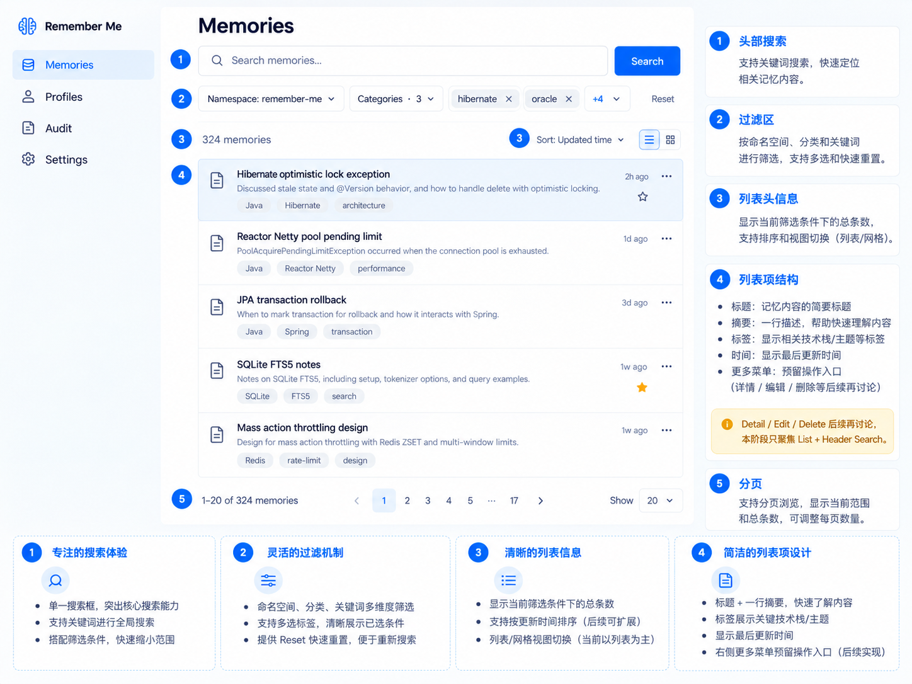
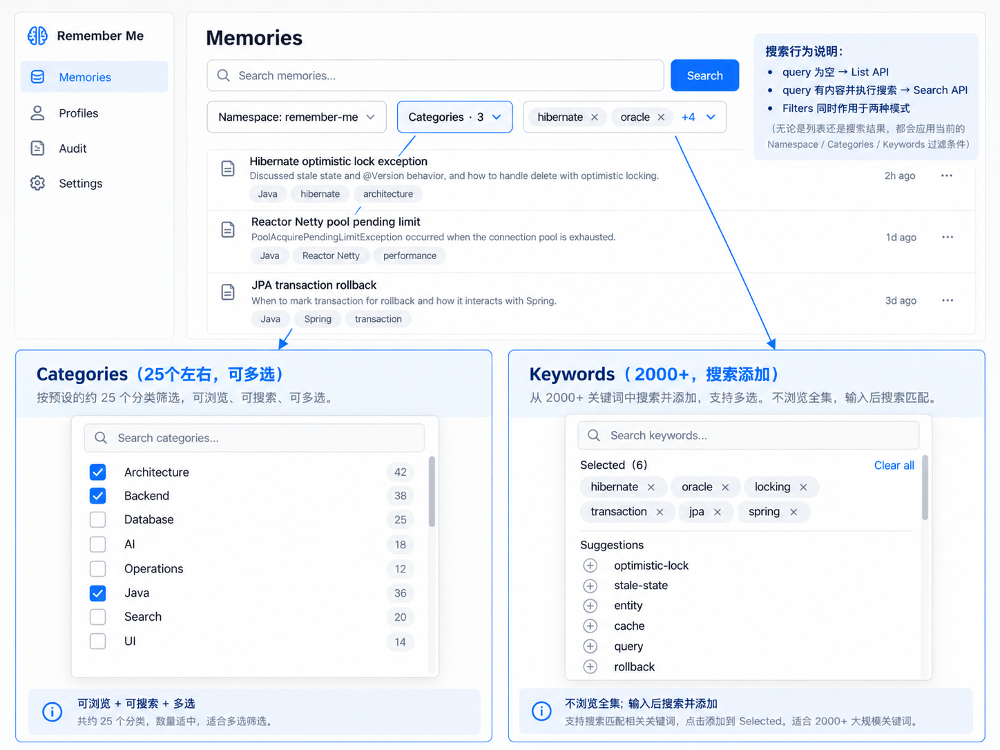
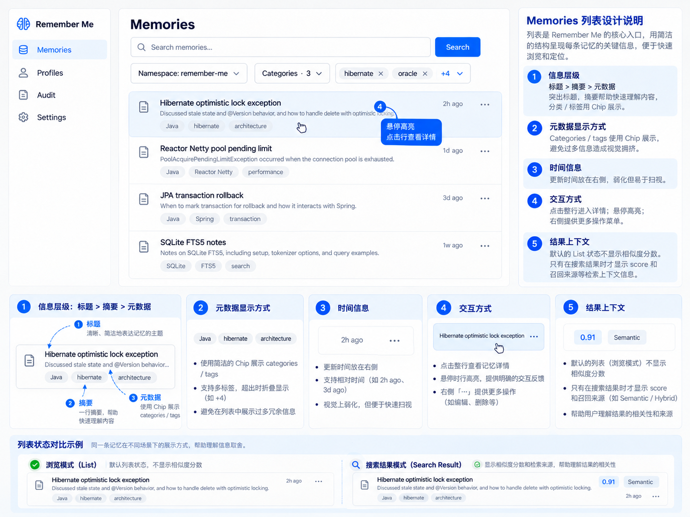

# Remember Me - Memories UI Specification

## 1. Goal

The Memories workspace is the primary place to **browse, narrow, search, and inspect the memory inventory**.

The design should feel:
- professional
- technical
- cohesive
- precise
- calm rather than visually noisy
- optimized for frequent developer / power-user use

The current phase deliberately focuses on **Search + Filters + List**. Memory Detail, Edit, and Delete are postponed to a later design phase.

---

## 2. Information architecture

Do **not** expose separate `List` and `Search` navigation entries.

Use a single top-level destination:

```text
Memories
```

The workspace has two internal data modes that are invisible to the user:

```text
query empty
  -> Browse mode
  -> List API

query submitted and non-empty
  -> Search mode
  -> Search API

query cleared
  -> Browse mode
  -> List API
```

The user should think:

> No query: I am browsing memories.
> Query entered: I am searching memories.

The UI should not ask the user to choose between “List mode” and “Search mode”.

---

## 3. Page structure

Recommended vertical hierarchy:

```text
Memories

[ Search memories..................................... ] [ Search ]

[ Namespace: ... ] [ Categories · N ] [ keyword ] [ keyword ] [+N]

N memories                                      Sort: Updated ↓

-------------------------------------------------------------
Memory row
Memory row
Memory row
...
-------------------------------------------------------------

1-20 of N memories                 pagination         Show 20
```

### Visual hierarchy

1. **Search** is the primary action.
2. **Filters** define the current scope.
3. **Result summary + sort** provide list context.
4. **Memory rows** are the primary working surface.
5. **Pagination** is secondary and visually quiet.

Avoid a dense enterprise-form toolbar where every control has equal visual weight.

---

## 4. Search behavior

### 4.1 Trigger

Search should be explicit rather than firing semantic search on every keystroke.

Recommended triggers:
- press `Enter`
- click `Search`

Do not invoke semantic Search API for `h`, `hi`, `hib`, etc.

### 4.2 Mode selection

Pseudo logic:

```text
if submittedQuery is blank:
    use List API
else:
    use Search API
```

Important distinction:
- `inputQuery`: what is currently typed in the field
- `submittedQuery`: the query currently driving results

This prevents changing the displayed result set before the user actually submits a new search.

### 4.3 Clearing search

When the search input is cleared:
- clear `submittedQuery`
- reset page to first page
- immediately return to List API
- preserve filters unless the user explicitly resets them

### 4.4 Filters during search

Filters remain active in Search mode.

Example:

```text
query = "optimistic lock delete"
namespace = remember-me
categories = [backend, architecture]
keywords = [hibernate, jpa]
```

The Search API receives all of these conditions.

---

## 5. Filter model

The common filter dimensions are:

```text
namespace
categories
keywords
```

They belong to the **Memories workspace**, not specifically to List or Search.

### 5.1 Logical semantics

Recommended semantics:

- Different dimensions: **AND**
- Multiple values inside one dimension: **OR**

Example:

```text
namespace = remember-me
AND
(category = backend OR category = architecture)
AND
(keyword = hibernate OR keyword = oracle)
```

This is the most predictable filtering model and avoids overly restrictive multi-select behavior.

---

## 6. Namespace filter

Current recommendation: **single select**.

Reasoning:
- Namespace behaves more like a scope / logical memory space than a tag.
- It should be visually stronger than Category and Keyword.

Example:

```text
[ Namespace: remember-me ▾ ]
```

Possible values:

```text
All namespaces
remember-me
project-a
project-b
personal
...
```

Changing namespace should:
- reset page to first page
- refresh the current mode (List or Search)
- refresh available Category / Keyword suggestions if those vocabularies are namespace-dependent

---

## 7. Categories filter

Current scale: approximately **25 categories**.

Use a **searchable multi-select popover**.

Recommended interaction:

```text
[ Categories · 3 ▾ ]

+---------------------------+
| Search categories...      |
+---------------------------+
| [x] Architecture          |
| [x] Backend               |
| [ ] Database              |
| [ ] AI                    |
| [ ] Operations            |
| ...                       |
+---------------------------+
```

Characteristics:
- multi-select
- checkbox list
- directly browsable
- searchable for speed
- selected count visible in the closed control

Because the set is only ~25, direct browsing remains useful.

---

## 8. Keywords filter

Current scale: **2000+ keywords**.

Do **not** expose a giant browseable dropdown.

Use a **search-to-add multi-select combobox**.

### 8.1 Interaction

```text
[ Keywords · 6 ▾ ]

+--------------------------------+
| Search keywords...             |
+--------------------------------+
| Selected                       |
| hibernate x   oracle x         |
| locking x     transaction x    |
|                                |
| Suggestions                    |
| + optimistic-lock              |
| + stale-state                  |
| + entity                       |
| + cache                        |
+--------------------------------+
```

The user searches for a keyword and adds it to the current filter set.

### 8.2 Closed-state presentation

Do not render a long ribbon of chips in the page header.

Preferred compact representation:

```text
[ hibernate x ] [ oracle x ] [ +4 ▾ ]
```

or, if space is tight:

```text
[ Keywords · 6 ▾ ]
```

Prefer the first form on wide desktop layouts because it exposes some active context without overwhelming the page.

### 8.3 Data loading

Do not preload all 2000+ keywords simply to populate the picker.

Recommended backend behavior:

```text
GET /keyword-suggestions?q=hib&namespace=remember-me&limit=20
```

Optionally include selected categories if useful:

```text
GET /keyword-suggestions
  ?q=hib
  &namespace=remember-me
  &categories=backend,architecture
  &limit=20
```

Keyword suggestions should therefore be:
- remote
- query-driven
- limited
- contextual to current scope where possible

---

## 9. Filter dependency

Recommended narrowing order:

```text
Namespace
   ↓
Categories
   ↓
Keyword suggestions
```

A change in namespace may alter available categories and keyword suggestions.

A change in categories may alter keyword suggestions.

Do not silently remove selected filters unless they become invalid. If invalidation is possible, surface it explicitly rather than silently changing the user's scope.

---

## 10. Result header

Directly above the list, show current result context:

```text
324 memories                              Sort: Updated time ▾
```

In Search mode the label may remain simple:

```text
12 memories                               Sort: Relevance ▾
```

Avoid verbose phrases such as “Search returned 12 results for …” unless needed for an empty/error state. The query is already visible in the search field.

### Sorting

For Browse/List mode, useful options include:
- Updated time
- Created time
- Title A-Z
- Title Z-A

For Search mode:
- Relevance should be available/default if supported
- Updated time may remain available

Do not expose unsupported sort options merely for visual completeness.

---

## 11. Search-result context

Default List mode should **not** display similarity scores.

If the Search API provides retrieval context, Search mode may add a small secondary indicator such as:

```text
0.91   Semantic
```

This should remain visually secondary to the actual memory content.

The exact search-debug representation can evolve later; do not turn the normal list into a retrieval laboratory in this phase.

---

## 12. Pagination

Use conventional pagination.

Example:

```text
1-20 of 324 memories          <  1  2  3  4 ... 17  >     Show 20 ▾
```

Recommended page sizes:
- 10
- 20 (default)
- 50

Changing search/filter/sort should reset to page 1.

Persisting the selected page size locally is reasonable but not required for the first implementation.

---

## 13. Reset behavior

Provide a low-emphasis `Reset` action near filters.

Reset should clear:
- namespace selection to default / all (depending on product semantics)
- categories
- keywords

Whether it also clears Search query should be an explicit product decision. Recommended behavior for this phase:

> Reset resets filters only; clearing the Search field controls Search/List mode.

This keeps the two concepts understandable.

---

## 14. Responsive behavior

The primary target is desktop.

On narrower layouts:
- Search remains full-width
- filters may wrap to the next line
- do not compress keyword chips until unreadable
- list content should retain its title / summary hierarchy

Do not prioritize mobile-specific restructuring in the current implementation phase unless mobile support is a requirement.

---

## 15. Deferred Detail behavior

The list must reserve a future interaction for opening Memory Detail.

For now, define only:

```text
click memory row
    -> open detail destination / panel hook
```

Do not finalize in this phase:
- detail layout
- edit fields
- save/cancel behavior
- delete action
- delete confirmation
- history presentation
- relationship / links UI

A right-side `...` action menu may also be visually reserved, but its final actions should wait for the Detail/Edit/Delete design phase.

---

## 16. Visual references

### Overall Search + Filter + List



### Filter interaction



### List item information hierarchy



The images are conceptual references. Implementation should preserve the agreed interaction model and hierarchy rather than pixel-copy every incidental detail.
